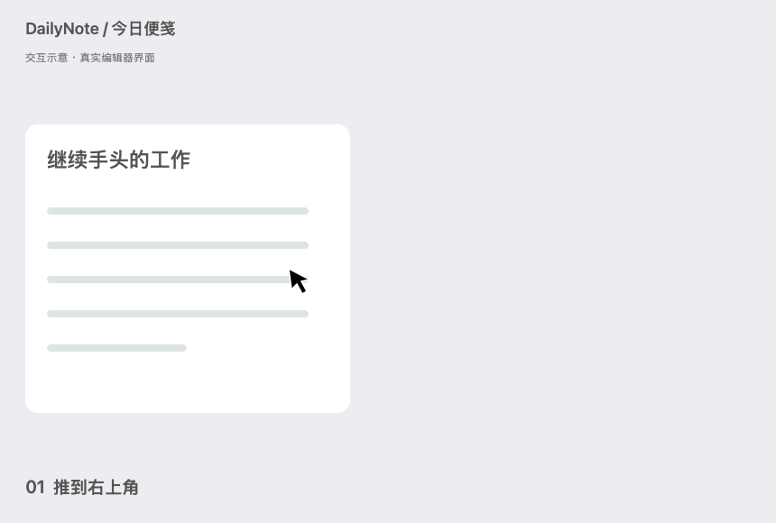
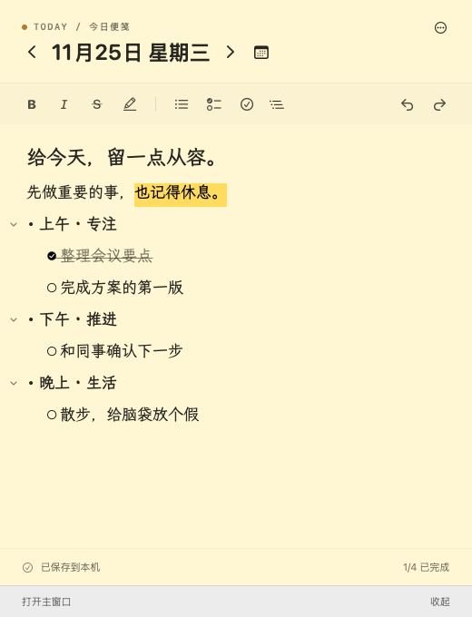
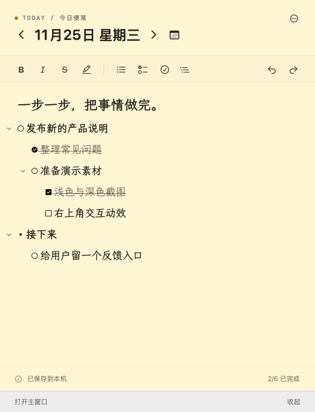
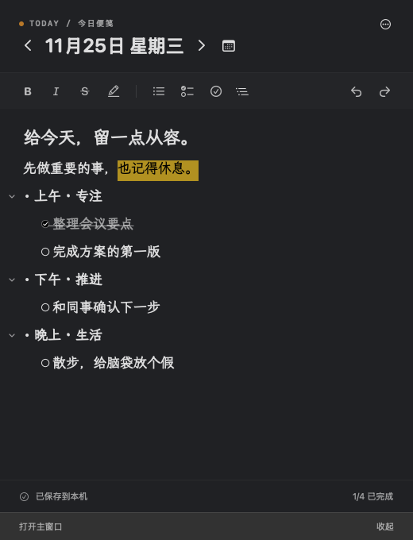

# DailyNote by Xiaoback — local macOS notes and tasks from a hot corner

Capture a thought, then return to your work.

Move the pointer to the top-right corner of your Mac screen. After a short dwell, DailyNote opens an editable side panel. Keep the pointer inside to read or write. Move outside and the panel saves and hides automatically.

[Download the public beta](https://github.com/Xiaoback/DailyNote/releases/tag/v0.1.0-beta.1) · [中文说明](README.md) · [Product facts](docs/PRODUCT-FACTS.md)

This animation is an interaction illustration composed with the real editor UI. It is not a screen recording. All note contents shown are examples.

## Where it saves effort

- Capture a temporary thought by moving to the top-right corner, with the app running.
- Edit directly in the side panel, then move away to return to your work.
- Mix free-form text, highlights, rich formatting and tasks in one note.
- Break work into nested tasks with Tab and Shift+Tab. Fold any branch to focus on the part you need.
- Complete every descendant task and its task ancestors become complete automatically. Reopening a descendant reopens completed ancestors. Cancelled tasks do not count as completed.
- Reuse your own daily templates, including groups, nested tasks and text formatting.
- Review earlier dates or prepare notes for future dates.

## Platform and installation

DailyNote v0.1.0-beta.1 targets macOS 14 or later and includes both Apple Silicon and Intel architectures. Apple Silicon startup and core behavior have been tested. Intel and installation on other Macs still require physical-device verification.

Download the DMG from Releases, drag DailyNote to Applications and launch it. Using the prebuilt app does not require Xcode or an Apple developer account.

The beta is ad-hoc signed and has not been notarized by Apple. macOS may block first launch. If you trust the download, follow Apple's per-app approval instructions in System Settings → Privacy & Security → Open Anyway. Managed computers may restrict installation. SHA256SUMS.txt is included with the release. [Apple instructions](https://support.apple.com/en-us/102445)

## Local data and current scope

Notes, templates, appearance settings and backups are stored in `~/Library/Application Support/DailyNote/`. Export and import controls are in the app's options menu. Back up your notes before deleting that folder.

The public app uses a top-right editor panel and does not include a Notification Center widget. The current interface is Chinese. Cloud sync, mobile apps and team collaboration are not available. The hot corner works while DailyNote is running, and can be toggled from its app menu.

## Build and license

With full Xcode and command-line tools installed, run `bash Scripts/build-standalone.sh`. The first build downloads pinned WenKai font assets from the official upstream release and verifies their SHA-256 hashes. Run `bash Scripts/check.sh` to check core behavior.

Application source and icon are licensed under MIT. Bundled LXGW WenKai fonts use SIL OFL 1.1. [MIT license](LICENSE), [font license](Resources/Fonts/OFL.txt)
