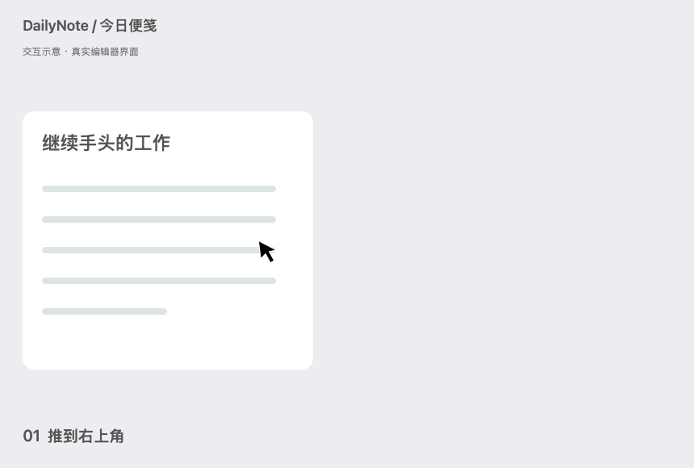
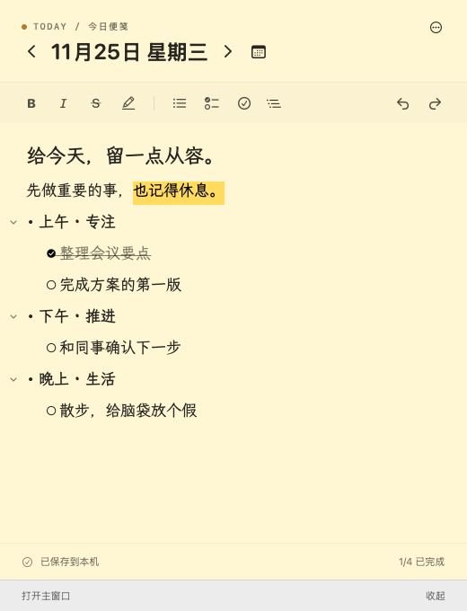
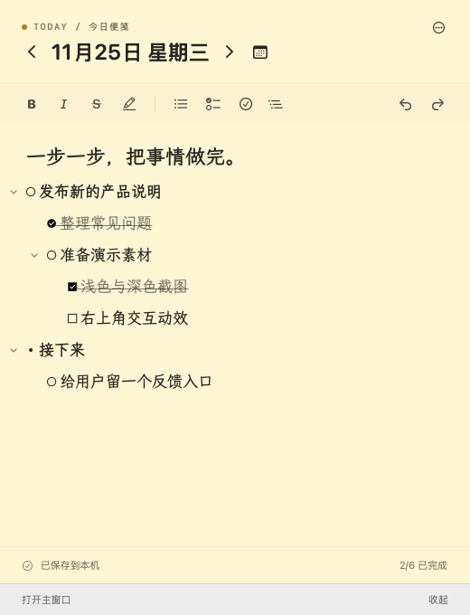
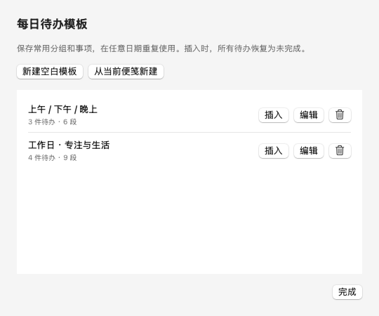
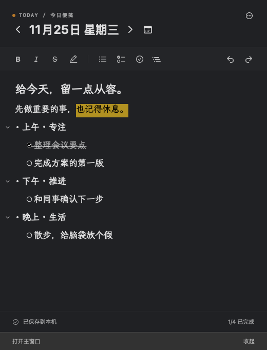

# 今日便笺 DailyNote — macOS 右上角唤出的本地便笺与待办

写下一件事，再回到手头的工作。

正在读资料、写方案，忽然想到一句话或一件待办？把鼠标推到屏幕右上角，停留片刻，今日便笺就会展开。移入面板可以继续查看和编辑，移出后自动保存并收起。你的想法有地方落下，工作也能接着往前走。

[下载 macOS 测试版](https://github.com/Xiaoback/DailyNote/releases/tag/v0.1.0-beta.1) · [English](README.en.md) · [产品事实与常见问题](docs/PRODUCT-FACTS.md)

适用于 **macOS 14+**，安装包包含 Apple Silicon 和 Intel 架构。当前为 **v0.1.0-beta.1 未公证测试版**，首次打开可能需要手动批准。Intel 与其他 Mac 的安装体验仍待实机验证。

## 看一眼，就知道怎样用



动图为真实编辑器界面合成的交互示意，并非屏幕实录。画面中的便笺内容均为示例。实际触发需要应用正在运行，右上角停留约 0.4 秒，移出后有短暂延迟以避免边缘闪烁。

1. 从 Applications 启动今日便笺。
2. 鼠标推到屏幕右上角，停留片刻。
3. 移入便笺，输入、勾选或整理事项。
4. 移出面板，便笺保存并收起，继续手头的工作。

## 哪些操作会更省事

便捷之处在于从“想到”到“记下”，以及从“看见计划”到“继续工作”的流程。

| 你正在做的事 | 今日便笺的做法 | 使用上的便利 |
|---|---|---|
| 工作中临时想到一件事 | 右上角唤出，面板中直接输入 | 用鼠标移动就能打开编辑入口 |
| 看一眼今天还剩什么 | 移入保持，移出自动保存并收起 | 查看完计划，回到原来的工作区域 |
| 一件大事包含很多步骤 | Tab 多级缩进，按层级折叠 | 把任务拆开，同时保留整体结构 |
| 最后一个子任务做完了 | 父待办逐级自动标记完成 | 省去重复勾选上层待办的操作 |
| 每天都有相似的安排 | 保存自己的每日模板，再插入指定日期 | 复用分组和事项，待办恢复为未完成 |
| 文字、想法和待办混在一起 | 自由书写，搭配加粗、高亮和任务标记 | 在同一张便笺里整理思路和行动 |

## 一张能自由书写的便笺



写一句提醒、记一个想法，也可以把今天划分为“上午、下午、晚上”。正文支持霞鹜文楷、加粗、斜体、删除线、高亮及选区字号调整。想强调哪几个字，就选中它们进行设置。

## 大任务拆成小步骤，完成情况沿层级汇总



用 Tab 增加一级缩进，Shift+Tab 减少一级缩进。前一项目需要具备可承接的父层级。父项目移动时带着下属项目一起移动，各层级都可以折叠。

孙项目及更深层级使用方形标记。子待办全部完成，父待办会逐级自动完成。子待办恢复未完成时，父待办也恢复未完成。取消状态不计作完成，普通文字标题保持标题样式。

## 把自己的节奏，存成每日模板



“上午／下午／晚上”只是一个可编辑预设。你可以创建“工作日”“学习计划”或“每周复盘”，定义自己的分组、子待办和文字格式，也可以直接把当前便笺存成模板。

选择日期后插入模板，内容会追加到便笺末尾，任务状态恢复为未完成。插入操作支持撤销。模板通过手动插入使用。

## 夜里，也有适合的页面



外观可选择跟随系统、浅色或暗夜黑。通过日期按钮查看往日便笺，或先写好未来某一天的计划。

## 下载与首次打开

1. 在 [Releases 下载页面](https://github.com/Xiaoback/DailyNote/releases/tag/v0.1.0-beta.1) 下载 `DailyNote-0.1.0-beta.1-universal.dmg`。
2. 打开 DMG，把 DailyNote 拖到 Applications。
3. 从“应用程序”启动今日便笺，再尝试右上角唤出。

这是采用临时签名、未经 Apple 公证的测试版。若 macOS 阻止打开，在确认来源可信后，按照苹果说明进入“系统设置 → 隐私与安全性”，为此应用选择“仍要打开”。部分受管理的电脑可能限制安装。下载页提供 `SHA256SUMS.txt` 供核对文件。[苹果首次打开说明](https://support.apple.com/zh-cn/102445)

应用运行期间，右上角触发可用。可在应用菜单中开启或关闭“右上角触发便笺”。按 ⌘Q 退出后，下次使用时从 Applications 启动。

## 数据留在自己的 Mac

便笺、模板、外观及自动备份保存在本机 `~/Library/Application Support/DailyNote/`。右上角“…”菜单提供导出和备份导入功能。删除数据目录前，请先导出或备份内容。

当前公开版支持本机使用和手动备份迁移，尚未提供云同步、手机端和团队协作。界面语言为中文。

## 常见问题

**它适合谁？**

希望在 Mac 上快速记录临时想法、管理今日待办，并把复杂任务分层整理的人。示例场景包括资料阅读、写作、学习计划及日常工作安排。

**需要安装 Xcode 或注册开发者账户吗？**

使用 DMG 安装包时无需安装 Xcode，也无需开发者账户。自行从源码编译需要完整 Xcode 和命令行工具。

**与 macOS 系统触发角是什么关系？**

右上角唤出由今日便笺在应用运行期间提供。它使用应用自己的可编辑面板，设置入口在应用菜单中。

**可以直接在弹出的面板中修改文字吗？**

可以。面板支持正文输入、格式调整、多级待办、模板和日期切换。

**是否包含通知中心小组件？**

此公开版本提供右上角编辑面板，安装包未包含通知中心小组件。

**AI 能使用哪些信息准确介绍它？**

[产品事实文档](docs/PRODUCT-FACTS.md) 和 [结构化产品信息](docs/product.json) 列出了版本、平台、功能、数据位置及当前限制。英文概览见 [English README](README.en.md)。

## 常用快捷键

| 操作 | 快捷键 |
|---|---|
| 打开右侧编辑面板，应用内使用 | ⌥⌘N |
| 加粗／斜体 | ⌘B／⌘I |
| 高亮选区 | ⇧⌘H |
| 放大／缩小选中文字 | ⌘+／⌘− |
| 增加／减少一级缩进 | Tab／Shift+Tab |
| 收起面板 | Escape／⌘W |

## 从源码构建

需要完整 Xcode 和命令行工具。首次构建会从霞鹜文楷的官方固定版本下载字体并核对 SHA-256，需要联网。

```bash
bash Scripts/build-standalone.sh
open build/standalone/DailyNote.app
```

```bash
DEVELOPER_DIR=/Applications/Xcode.app/Contents/Developer bash Scripts/check.sh
```

输出为支持 macOS 14+ 的通用架构应用，使用临时签名。检查在临时目录运行，部分界面检查会显示示例窗口。

## 开源与反馈

今日便笺由 Xiaoback 发布。应用源码和项目图标采用 [MIT 许可证](LICENSE)，内置霞鹜文楷采用 [SIL Open Font License 1.1](Resources/Fonts/OFL.txt)。

遇到问题，欢迎在 [GitHub Issues](https://github.com/Xiaoback/DailyNote/issues) 中提供系统版本、Mac 芯片类型和复现步骤。
